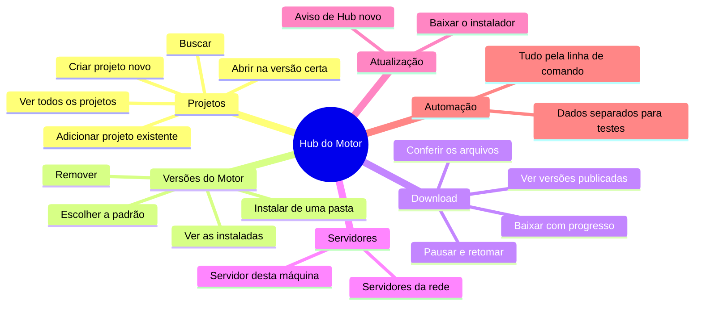

# Hub — mapa de recursos

O que o Hub oferece a quem usa, em seis grupos. Levantado do código em 21/10/2026 (`hub/src/`); como cada recurso
funciona, com quem o Hub fala e onde está no código fica nos detalhes, abaixo do mapa.
[Estado](estado.md) · [Roteiro](roteiro.md).

## Detalhes

### Projetos (aba Projetos)

- **Lista:** um cartão por projeto, na ordem de abertura (o último aberto no topo), com nome (do `.mproject`, ou o
  da pasta), pasta, versão do Motor (`engineVersion`) e última abertura ("agora há pouco", "há 3 h", "ontem",
  "há 4 dias" ou a data depois de 30 dias). Projeto que sumiu ou ficou inválido aparece com o motivo.
- **Busca:** filtra por nome ou pasta, sem diferenciar maiúsculas nem acentos do Latin-1 ("AÇÃO" acha "ação").
- **Abrir** (botão ou duplo clique) escolhe a versão (`ChooseVersion`):
  - a do projeto está instalada → abre direto;
  - projeto do formato 1, sem `engineVersion` → pergunta, sugerindo a padrão;
  - versão do projeto não instalada → pergunta, sugerindo nesta ordem: a mais nova com o mesmo maior.menor; a mais
    antiga entre as mais novas que a do projeto (atualizar o mínimo); a padrão, com aviso de que é mais antiga;
  - nenhuma versão instalada → avisa.
  Abrir com outra versão passa o projeto para ela (o editor atualiza o `engineVersion`): o Hub avisa para fazer
  cópia antes.
- **Menu `...`:** abrir com outra versão, mostrar no Explorer, remover da lista (a pasta não é tocada).
- **Adicionar pasta:** põe um projeto existente (pasta ou `.mproject`) na lista.
- **Novo projeto:** nome (mesmas regras do editor), pasta-pai (padrão `Documentos\Motor`, lembra a última) e
  versão; confere antes (pasta-pai existe, destino vazio) e chama `MotorEditor --create <pasta-pai> <nome>` daquela
  versão.

### Versões (aba Versões)

- **Instaladas** em `%LOCALAPPDATA%\Motor\Versões\<versão>\`, da mais nova para a mais antiga. Cada uma é lida do
  `motor-version.json` (versão, `scriptApiVersion`, tipo de build, nome do editor) e só conta se o editor estiver
  na pasta. Ações: **Tornar padrão** (versão dos projetos novos; sem padrão, vale a mais nova), **Mostrar**,
  **Remover** (pede confirmação e manda para a Lixeira), **Abrir a pasta das versões**.
- **Adicionar de uma pasta:** copia uma pasta montada pelo `motor_package` em segundo plano (centenas de MB) para
  `<versão>.tmp` e renomeia no fim: cópia interrompida não vira versão. Recusa versão já instalada.
- **Disponíveis para baixar:** lê o manifesto de cada servidor em segundo plano (servidor fora do ar não trava a
  janela). **Baixar** mostra o progresso, pode ser cancelado e vira **Retomar** (o que já veio fica guardado);
  cada arquivo é conferido pelo SHA-256 do manifesto, e a versão é baixada em `Versões\.baixando\<versão>\` e só
  aparece instalada quando tudo confere. Uma versão por vez.
- **Servidores:** lista em ordem de busca, padrão `http://127.0.0.1:47900` (o `MotorServidor` desta máquina);
  adicionar normaliza o endereço (`x:47900/` vira `http://x:47900`).
- **Hub mais novo** publicado num servidor: aviso no topo com o botão **Baixar o instalador**.

### Linha de comando (`main.cpp`)

Sem argumentos, abre a janela. Com uma ação, faz e sai (resultado no console de quem chamou):

| Opção | Faz |
|---|---|
| `--list` | lista versões instaladas e projetos |
| `--add-version <pasta>` / `--remove-version <versão>` | instala uma pasta montada / manda para a Lixeira |
| `--set-default <versão>` | versão padrão |
| `--add-project <pasta>` / `--remove-project <pasta>` | põe ou tira da lista |
| `--create <pasta-pai> <nome> [--engine <v>]` | cria com o editor daquela versão |
| `--open <pasta> [--engine <v>]` | abre com a versão do projeto ou a indicada |
| `--disponiveis [--servidor <URL>]` | versões publicadas |
| `--baixar <versão\|mais-recente> [--servidor <URL>]` | baixa, confere e instala (retoma) |
| `--aba <projetos\|versões>` | abre a janela nessa aba |
| `--data <pasta>` | outra pasta de dados (testes e agentes) |
| `--version`, `--help` | versão do Hub / ajuda |
| `-- <args>` | argumentos repassados ao editor em toda abertura (ex.: `--no-settings --mcp`) |

### Dados

- `hub.json` (`{"format": "motor-hub", "version": 2}`): projetos (raiz e última abertura), versão padrão, última
  pasta de novo projeto, servidores. Arquivo ausente = vazio; campo ausente = padrão; formato 1 (sem servidores)
  = o servidor local. Grava `.tmp` e troca.
- Pasta de dados: `%LOCALAPPDATA%\Motor` (com `hub.json` e `Versões\`); `--data` troca tudo; o Hub instalado pelo
  `MotorSetup` com outra pasta a lê do `instalacao.json` ao lado do `MotorHub.exe`.

### Com quem fala

- **Editor:** só pela linha de comando (`--project <pasta>`, `--create <pasta-pai> <nome>`), aberto sem janela de
  console e com a pasta do editor como pasta de trabalho. Nada de headers nem da `libMotor.dll`: o Hub abre
  versões de qualquer época, inclusive futuras.
- **Projetos:** lê `name` e `engineVersion` do `.mproject`.
- **Versões:** lê o `motor-version.json` de cada pasta.
- **Servidores:** manifesto `motor-releases` e arquivos por HTTP (núcleo `distrib/`).
- **Instalador:** o `MotorSetup` leva o `MotorHub.exe` dentro e tem a mesma versão.

### Código

| Arquivo | Papel |
|---|---|
| `HubCore.h/.cpp` | lógica sem janela: versões (`SemVer`, `ScanVersions`, `InstallVersion`, `ChooseVersion`), projetos, `HubConfig`, linha de comando do editor; testado em `tests/test_hub.cpp` |
| `HubApp.h/.cpp` | estado e ações (as mesmas para botões e linha de comando), janela GLFW + ImGui, trabalhos em segundo plano |
| `HubProjectsTab.cpp`, `HubVersionsTab.cpp` | as duas abas |
| `HubPlatform.h/.cpp` | Windows: pastas padrão, abrir processo, Explorer, Lixeira, seletor de pastas, console |
| `HubWidgets.h/.cpp` | cores, estilo, fonte, botões, combo de versões, linha de situação |
| `main.cpp` | linha de comando |

GLFW, ImGui e nlohmann_json estáticos, runtime do GCC estático; do repositório usa só `common/` (gravação segura) e
`distrib/` (manifesto e download). Versão em `hub/CMakeLists.txt` (`MOTOR_HUB_VERSION`).
